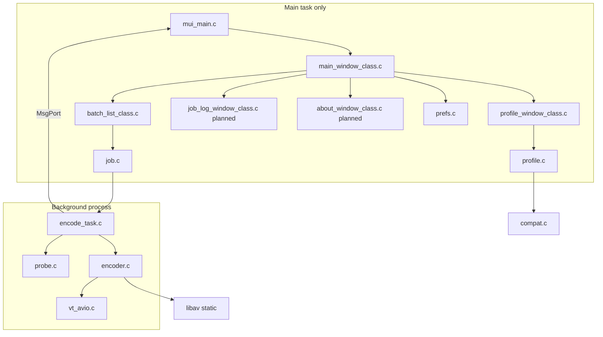

# VideoTranscoder — Step-by-step implementation plan

This document turns [requirements.md](requirements.md) into an ordered build checklist. Product decisions there are locked; do not change the requirements file when following this plan.

**Build machine:** MorphOS with `ppc-morphos-gcc-15`, `-noixemul`, `-mcpu=G4`. Headers live in `include/`; static `.a` archives in `lib/`. Do not download toolchains or build FFmpeg on Ubuntu.

**Architecture (MVC):**

**Rules on every step:**

- Views and MUI classes never call libav*.
- `encoder.c`, `probe.c`, `vt_avio.c`, and `encode_task.c` never include MUI headers.
- One implementation per behavior; reuse `vt_util.c`, `compat.c`, and existing model APIs.
- Jobs are updated on the **main task** only (via `VT_Encode_Drain` → `VT_JobSet*`).
- Serial queue: one encode at a time on the background process.

---

## Legend

| Mark | Meaning |
|------|---------|
| [x] | Done in the current tree |
| [ ] | Not done yet |

---

## Phase 1 — Models (no GUI)

### Step 1.1 — Shared types and utilities [x]

**Files:** `vt_types.h`, `vt_util.h`, `vt_util.c`, `macros.h`

- Path/name lengths, strict string copy, Amiga path join, atomic text write, `DeleteFile` (not `Delete`).
- **Verify:** unit-style compile of `vt_util.c` on MorphOS; no implicit declarations (GCC 15).

### Step 1.2 — Compatibility matrix [x]

**Files:** `compat.h`, `compat.c`

- Containers: MP4, MKV, MOV, AVI. Video: MPEG-2, MPEG-4, H.264, copy. Audio: MP3, AC-3, AAC, copy.
- `VT_CompatVideo`, `VT_CompatAudio`, `VT_CompatPair`; tokens/labels/extensions for profiles and UI.
- **Verify:** illegal pairs return FALSE; copy allowed in every container per requirements table.

### Step 1.3 — Profile model and on-disk format [x]

**Files:** `profile.h`, `profile.c`

- Defaults: MPEG-4, MP3, MKV, 2500 / 192 kbit/s, gain 0, single pass.
- Validate bitrates, gain −24…24, two-pass cleared when video is copy.
- `PROGDIR:Profiles/<name>.profile`, magic `VTPROFILE 1`; store keeps loaded path for rename/delete.
- **Verify:** empty profile drawer creates Default; duplicate names on load are skipped.

### Step 1.4 — Preferences [x]

**Files:** `prefs.h`, `prefs.c`

- `ENVARC:VideoTranscoder.prefs`, magic `VTPREFS 1`: output drawer, active profile, window rectangle.
- **Verify:** missing file → defaults; bad window fields fall back safely.

### Step 1.5 — Job queue model [x]

**Files:** `job.h`, `job.c`

- Status: waiting, running, done, failed, cancelled. Monotonic job ids.
- Profile snapshot per job; probe fields; `VT_JobAssignOutput` (basename + extension, `-2`, `-3`, never overwrite, skip same path as source).
- Running job cannot be removed; clear skips running.
- **Verify:** setters clear error/progress per status rules in `job.c`.

---

## Phase 2 — Shell UI

### Step 2.1 — Shared UI tags and class helpers [x]

**Files:** `vt_ui.h`

- Custom attributes for jobs, profiles, prefs, windows; methods for batch, profiles, encode notes.
- `VT_SuperNew` for tag lists; `nnset` if missing from MUI headers.

### Step 2.2 — Batch list class [x]

**Files:** `batch_list_class.c`

- Subclass `MUIC_List`; columns Source, Profile, Status (includes failed error text), Progress, Output basename.
- Hooks via `EmulLibEntry` positional `{ TRAP_LIB, 0, fn }`.
- `MUIM_VT_BatchSync`, `MUIM_VT_BatchGetActive`.
- **Verify:** list refreshes from `VTJob*` pointers without owning jobs.

### Step 2.3 — Profile editor window [x]

**Files:** `profile_window_class.c`

- Cycles from `compat.c`; illegal codecs hidden after container change.
- 2-pass disabled when video is copy; audio bitrate/gain disabled when audio is copy.
- G4 slow note when H.264 or 2-pass (and not video copy).
- **Verify:** Save runs `VT_ProfileValidate`; New/Edit/Duplicate/Delete call profile store.

### Step 2.4 — Main window [x]

**Files:** `main_window_class.c`

- Add (ASL multi-select files), Remove, Clear, Start, Stop; output drawer string + popasl; profile cycle + profile buttons; gauge + status.
- Restore window size from prefs when valid.
- `#include "prefs.h"` for `VTPrefs`; no `MUIA_Listview_DefHeight`.
- **Verify:** Start/Stop wired to encode supervisor (Phase 3).

### Step 2.5 — Application entry [x]

**Files:** `mui_main.c`

- Init profile store, job list, prefs, custom classes; `ApplicationObject` with main + profile subwindow.
- Loop: `MUIM_Application_NewInput`, drain encoder port, `MUIM_VT_EncodeNote` on main window.
- **Verify:** quit saves prefs via `MUIM_VT_SavePrefs`.

### Step 2.6 — Makefile (UI + models) [x]

**Files:** `Makefile`

- `ppc-morphos-gcc-15`, G4 flags, `-L./lib`, static libav group as on MorphOS build.
- **Verify:** `make` on MorphOS produces `VideoTranscoder` when `lib/` is populated.

---

## Phase 3 — Encode path (default profile)

### Step 3.1 — DOS-backed AVIO [x]

**Files:** `vt_avio.h`, `vt_avio.c`

- Open/read/write/seek via `Seek64`; custom `AVIOContext` so `volume:path` is not parsed as URL scheme.
- `VT_FileProbeURL` uses `file:<basename>` for libav open.
- Interrupt callback for cancel during demux.
- **Verify:** probe and encode open local MorphOS paths with colon volumes.

### Step 3.2 — Probe [x]

**Files:** `probe.h`, `probe.c`

- Duration, size, first video/audio codec names via libavformat; no MUI.
- **Verify:** encode task posts probe to main task; `VT_JobSetProbe` fills job (UI log comes in Phase 5).

### Step 3.3 — Encoder (MPEG-4 / MP3 / MKV, single pass) [x]

**Files:** `encoder.h`, `encoder.c`

- Decode best video + optional audio; scale to YUV420P; MPEG-4 + LAME/MP3; Matroska mux; custom output IO.
- Progress from duration or byte position; cancel between packets; delete partial output on failure/cancel.
- `VT_EncodeSupported` gates **only** MKV + MPEG-4 + MP3 + single pass + gain 0; other snapshots fail with clear error.
- **Verify:** default profile transcodes a short test clip; cancel removes `.mkv` partial file.

### Step 3.4 — Background queue supervisor [x]

**Files:** `encode_task.h`, `encode_task.c`

- One `CreateNewProc` worker; messages: job, claim output (main task assigns path + RUNNING), probe, progress, finished, idle.
- Stop bumps batch id + cancel flag; quit on app exit.
- **Verify:** two waiting jobs run one after another; Stop cancels current only; failed job does not stop queue.

### Step 3.5 — Wire Start/Stop and main loop [x]

**Files:** `main_window_class.c`, `mui_main.c`, `vt_ui.h` (`MUIM_VT_EncodeNote`)

- Start: drawer, waiting jobs, `VT_Encode_Submit`.
- Stop: `VT_Encode_Stop`.
- **Verify:** gauge averages job progress; status line updates from drain.

---

## Phase 4 — Full codec surface

Extend `encoder.c` and relax `VT_EncodeSupported` / `VT_EncodeUnsupportedReason` so any **valid** profile snapshot (per `VT_ProfileValidate` and `compat.c`) encodes. Keep a single encode pipeline; branch on copy vs re-encode and on container muxer name.

### Step 4.1 — Container muxers [ ]

**Owner:** `encoder.c` (and small helpers if needed, not duplicate path logic)

| Container | `avformat_alloc_output_context2` format |
|-----------|----------------------------------------|
| MKV | `matroska` |
| MP4 | `mp4` |
| MOV | `mov` |
| AVI | `avi` |

- Honor `AVFMT_GLOBALHEADER` for MP4/MOV when required.
- **Verify:** each container with a legal codec pair produces a playable file on MorphOS.

### Step 4.2 — Video encoders [ ]

**Owner:** `encoder.c`

| Profile codec | Encoder |
|---------------|---------|
| MPEG-2 | `AV_CODEC_ID_MPEG2VIDEO` |
| MPEG-4 | existing path |
| H.264 | `libx264` via `avcodec_find_encoder_by_name("libx264")`, set bitrate, GOP; respect profile two_pass (Step 4.5) |
| Copy | remux bitstream (`av_packet` rescale, no decode) |

- Single-threaded contexts (`thread_count = 1`).
- **Verify:** H.264 profile on G4 completes (slow is OK); copy preserves video when container allows.

### Step 4.3 — Audio encoders [ ]

**Owner:** `encoder.c`

| Profile codec | Encoder |
|---------------|---------|
| MP3 | existing LAME path |
| AC-3 | FFmpeg AC-3 encoder |
| AAC | FFmpeg AAC encoder |
| Copy | remux audio packets |

- Reuse swresample path for re-encode; pick sample rate/format via `avcodec_get_supported_config` (same pattern as MP3).
- **Verify:** AC-3 in AVI, AAC in MP4/MOV per matrix.

### Step 4.4 — Audio gain (re-encode only) [ ]

**Owner:** `encoder.c` (libavfilter)

- When `audio_codec != copy` and `audio_gain_db != 0`, insert volume filter (or equivalent) in audio path before encoder.
- No gain on copy/remux.
- **Verify:** audible level change on test clip; copy profile ignores gain.

### Step 4.5 — Two-pass H.264 (and MPEG-4 if applicable) [ ]

**Owner:** `encoder.c`

- Stats file on `T:` (unique per job id or output stem); delete on done, failed, or cancel (same as partial output).
- Pass 1: write stats; pass 2: read stats and mux. UI already disables two-pass when video is copy.
- **Verify:** cancel during pass 2 removes stats + partial output; single-pass unchanged.

### Step 4.6 — Stream copy / remux mode [ ]

**Owner:** `encoder.c`

- Video copy + audio copy: demux → interleaved write (no bitrate/gain/2-pass).
- Mixed copy + re-encode: one stream copied, other transcoded (still one output timeline; may require decode for sync on hard cases—prefer libav remux patterns).
- **Verify:** MKV→MKV copy is fast and size-stable; incompatible pairs still blocked by `compat.c` before encode starts.

### Step 4.7 — Expand support gate [ ]

**Files:** `encoder.c`, `encode_task.c`

- Replace narrow `VT_EncodeSupported` with: `VT_ProfileValidate` + `VT_CompatPair` + explicit “encoder not built” only for unimplemented branches during development.
- Remove generic “This version encodes…” once Phase 4 is complete.
- **Verify:** every row in requirements compatibility table works in a manual matrix test.

---

## Phase 5 — Polish and remaining UI

### Step 5.1 — Drag and drop [ ]

**Owner:** `main_window_class.c` (view), reuse `VT_JobListAdd` + active profile snapshot

- Enable `MUIA_Window_AppWindow` on main window; handle AppWindow drop messages.
- **Files:** enqueue paths from dropped files.
- **Drawers:** list that drawer only (`Examine`/directory iteration); do **not** recurse into subdrawers.
- Reuse same “real file” filtering as ASL Add where possible (one helper in `vt_util.c` or `main_window_class.c`, not a second queue path).
- **Verify:** drop file and drop drawer add waiting jobs; subdrawer files are not added.

### Step 5.2 — Output drawer memory [x]

Already in prefs + main window (`MUIM_VT_DrawerChanged`, `MUIM_VT_SavePrefs`, popasl initial drawer).

- **Verify:** restart app restores drawer and window position.

### Step 5.3 — Profile files on disk [x]

Already in `profile.c` load/save/create/delete.

- **Verify:** copy `Profiles/` folder to second machine and load names/settings.

### Step 5.4 — Job log window [ ]

**New files:** `job_log_window_class.c`, hooks in `vt_ui.h`, register in `mui_main.c` as subwindow or modal.

- Show selected job: source, duration, probe video/audio, size, output path, error text.
- Open from main window (button or menu); read-only; no libav in class.
- **Verify:** after failed encode, log shows `VTJob.error`; after run, probe fields match probe step.

### Step 5.5 — About window [ ]

**New files:** `about_window_class.c`

- App name, version string (match `MUIA_Application_Version`), freeware statement.
- Static text: GPL due to libx264; credits for FFmpeg, LAME, libx264.
- No URLs, no update check, no network APIs.
- **Verify:** window opens/closes; no link gadgets that fetch.

### Step 5.6 — Makefile and class init [ ]

- Add new `.c` files to `UI_SRCS`; depend on `vt_ui.h`.
- Export `VT_JobLogWindow_Init/Exit`, `VT_AboutWindow_Init/Exit` like other classes.
- **Verify:** clean `make distclean && make`.

---

## Phase 6 — Release checklist (MVP sign-off)

Run on MorphOS hardware (G4-class):

1. **Offline:** no opens to network stacks; grep binary/strings optional for http/ssl usage beyond static ffmpeg deps.
2. **Batch:** add many files, clear, remove, start queue, stop mid-job, cancel leaves prior done jobs.
3. **Profiles:** create, rename, duplicate, delete, illegal codec disabled in UI.
4. **Matrix:** one short source per legal container/codec row in requirements §4.
5. **2-pass:** start cancel finish; confirm `T:` stats removed.
6. **Output naming:** existing file → `-2` suffix; never overwrites source path.
7. **GPL shipping:** About text matches libx264-linked binary.

---

## Source file map (target end state)

| File | Role | Phase |
|------|------|-------|
| `mui_main.c` | App, input loop, encoder drain | 2, 3, 5 |
| `main_window_class.c` | Home screen, Start/Stop, ASL, DnD | 2, 3, 5 |
| `batch_list_class.c` | Queue view | 2 |
| `profile_window_class.c` | Profile editor | 2 |
| `job_log_window_class.c` | Probe/error view | 5 |
| `about_window_class.c` | Licenses | 5 |
| `job.c`, `profile.c`, `prefs.c` | Models | 1 |
| `compat.c` | Matrix | 1, 4 |
| `vt_util.c` | Shared helpers | 1, 5 |
| `vt_avio.c` | MorphOS file IO for libav | 3 |
| `probe.c` | Probe | 3 |
| `encoder.c` | Transcode/remux/2-pass/gain | 3, 4 |
| `encode_task.c` | Serial worker + MsgPort | 3 |
| `Makefile` | MorphOS link line | 2–5 |

---

## Out of scope (do not implement for MVP)

Network, analytics, update checks, license keys, parallel encodes, subtitle burn-in, filters beyond audio gain, hardware encoders, recursive folder scan — per requirements § “Out of scope”.

---

## Related documents

- Product spec: [requirements.md](requirements.md)
- MUI/engine conventions: project `.cursorrules`
