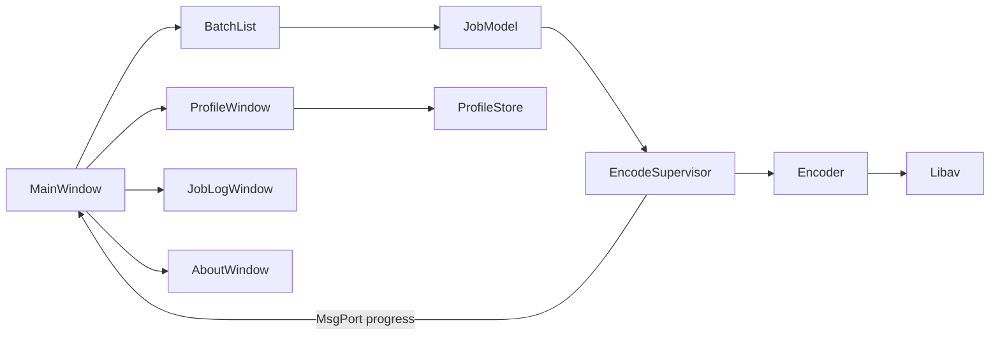

# VideoTranscoder — Product & Engineering Requirements

MorphOS MUI 5 video transcoder with a statically linked libavcodec-based encoder. Freeware, fully offline, no analytics.

---

## 1. One-sentence description

**VideoTranscoder** is a freeware, fully offline MorphOS application that lets power users batch-transcode video through a MUI 5 interface, using saved profiles and an in-process statically linked libavcodec encoder.

---

## 2. Target user

A **MorphOS power user** on G4-class PowerPC hardware who already thinks in codecs, bitrates, and containers. They use the ffmpeg command line today and want the same control with a queue, drag-and-drop, a remembered output drawer, and profiles they can create and reuse. They expect a native MUI 5 program that **never opens a network connection**.

---

## 3. Core use case

Drop one or more files (or a drawer of files) onto the main window, choose or edit a profile, choose an output drawer, and run the queue. Each job shows status and progress. The user can cancel the running job. A failed file is marked failed and the queue continues.

Settings that define a profile:

- Video codec and bitrate (or video copy)
- Audio codec and bitrate (or audio copy)
- Audio gain
- 2-pass encoding
- Container format (mp4, mkv, mov, avi)

**Serial encoding only:** one job at a time. A single G4 should not run parallel encodes.

---

## 4. Minimum Viable Product (MVP) feature list

### Batch queue

- Add, remove, clear, start, stop.
- Columns: source name, profile, status (waiting, running, done, failed, cancelled), progress, output file.
- Probe each added file with **libavformat** and store duration, video codec, audio codec, and file size on the job.

### Encode settings (profile)

| Setting | Options / behavior |
|--------|---------------------|
| Video bitrate | kbit/s |
| Audio bitrate | kbit/s |
| Video codecs | MPEG-2, MPEG-4 (ASP), H.264 (libx264) |
| Audio codecs | MP3 (LAME), AC-3 (FFmpeg), AAC (FFmpeg) |
| Audio gain | dB; applied only when audio is re-encoded |
| 2-pass | Stats file on `T:`; removed when job ends or is cancelled |
| Video copy / audio copy | Remux only; bitrate, gain, and 2-pass do not apply to copied streams |
| Containers | mp4, mkv, mov, avi |

### Container / codec compatibility (UI-enforced)

Illegal pairs are disabled before encode starts.

| Container | Allowed (MVP) |
|-----------|----------------|
| **MKV** | All MVP video and audio codecs |
| **MP4** | MPEG-4, H.264, AAC, MP3 |
| **MOV** | MPEG-4, H.264, AAC, MP3 |
| **AVI** | MPEG-2, MPEG-4, MP3, AC-3 |

H.264, AAC, and MPEG-2-in-MP4 are refused in the UI where the container cannot carry them cleanly.

### Input and output

- **Drag and drop** of files and drawers onto the main window (`MUIA_Window_AppWindow`). A dropped drawer enqueues recognized media in that drawer only (not subdrawers).
- **Output drawer** via ASL requester; path remembered between sessions.
- Output filename: source basename + container extension. Never overwrite silently; append `-2`, `-3`, … if the target exists.

### Profiles and preferences

- User profiles: create, rename, duplicate, delete, save.
- Profile files: versioned text in `PROGDIR:Profiles/` (portable between machines).
- App prefs in `ENVARC:VideoTranscoder.prefs`: last output drawer, active profile, window position.

### Reliability and feedback

- **Cancel:** stop at next packet; delete partial output and 2-pass stats; leave completed jobs untouched.
- Per-job error text on probe or encode failure.
- **Default profile (G4-friendly):** MPEG-4, MP3, MKV, single pass, moderate bitrates, gain 0. H.264 and 2-pass remain available; profile UI notes they are much slower on a G4.

### About / licensing

- About window: version, freeware notice, third-party credits for statically linked **libx264 (GPL)**, **LAME**, and **FFmpeg**. The shipping binary is **GPL** because of libx264.

---

## 5. Main windows

| Window | Purpose |
|--------|---------|
| **Main** | Batch list; Add / Remove / Clear; Start / Stop; output-drawer popup; profile cycle; overall progress; status line. Home screen. |
| **Profile** | Name, container, video codec or copy, video bitrate, 2-pass, audio codec or copy, audio bitrate, audio gain; Save / Cancel; G4 speed note when H.264 or 2-pass is selected. |
| **Job log** | Probe summary and encoder error for the selected job. |
| **About** | App name, version, freeware, license notices. No update button, no URL fetch. |

ASL requesters for adding files and choosing the output drawer are system requesters, not separate app windows.

### Architecture (MVC)

---

## 6. Build plan (MorphOS MUI app)

### Repository context

- [Makefile](../Makefile): `ppc-morphos-gcc-15`, `-noixemul`, `-mcpu=G4`.
- [macros.h](../macros.h): MUI class dispatcher macros.
- Headers: `include/` (libav*, x264, LAME). Static `.a` libraries are linked on the MorphOS build machine (expected under `libs/` or an existing local path).
- **Do not** download toolchains or build FFmpeg on Ubuntu; compile and test on MorphOS.

### Architecture rules

- C, **MUI 5** custom classes, **MVC**.
- Views do not call libav*.
- Encoder layer does not include MUI headers.
- One implementation per behavior; no duplicate code.
- **Engine:** statically link libav*; encode on a **background Exec task**; progress via **message port** to the main task; **MUI only on the main task**.

### Proposed source layout

| File | Role |
|------|------|
| `mui_main.c` | Application object, main loop, input handler draining encoder message port |
| `main_window_class.c` | Main window class |
| `batch_list_class.c` | Queue list class |
| `profile_window_class.c` | Profile editor class |
| `job_log_window_class.c` | Probe and error display |
| `about_window_class.c` | License credits |
| `job.c`, `profile.c`, `prefs.c` | Models |
| `compat.c` | Container / codec matrix |
| `probe.c` | libavformat probe |
| `encoder.c` | Decode, audio gain filter, encode or stream copy, 2-pass, progress callback |
| `encode_task.c` | Background task, serial queue, cancel flag, messages to main task |

### Linking (MorphOS)

Link order as required by the static build, typically including:

`avfilter`, `avformat`, `avcodec`, `swresample`, `swscale`, `avutil`, `x264`, `mp3lame`, plus **MUI**.

Run libavcodec **single-threaded** unless the MorphOS static build already provides pthreads; UI stays on the main task regardless.

### Implementation phases

1. **Models:** job, profile, prefs, compatibility matrix (no GUI).
2. **Shell UI:** main window, batch list, profile window wired to models.
3. **Encode path:** probe; single-pass default (MPEG-4 / MP3 / MKV) on background task with progress and cancel.
4. **Full codec surface:** remaining codecs and containers, audio gain, stream copy, 2-pass.
5. **Polish:** drag and drop, output-drawer memory, profile files on disk, job log, About / licenses.

---

## Product decisions (locked)

| Topic | Decision |
|-------|----------|
| Target user | Power users (codecs, bitrates, batch, profiles, 2-pass) |
| UX priority | Batch list and encode settings are equally first-class |
| MVP scope | Full feature list in first release |
| Monetization | Freeware |
| Analytics | None; fully offline |
| Encoding | In-process static libav*, background Exec task |

---

## Out of scope (MVP)

Network access, analytics, update checks, license keys, parallel encodes, subtitle burn-in, filters beyond audio gain, hardware encoders, recursive folder scanning.

---

## Competitors (reference)

On MorphOS, users often rely on **ffmpeg** from the shell or scripts. VideoTranscoder differentiates with native MUI, batch queue, drag-and-drop, saved profiles, and container/codec guardrails—not with cloud services or a broader filter graph.
